# Verslag HD-proefversie Locals: Gulpen

> Dit verslag wordt per stap bijgewerkt en meegepusht. Alles wat hier staat is echt gedaan en gemeten.

## Samenvatting

(wordt aan het eind ingevuld)

## Plan

Volgorde: van het meeste visuele effect naar het minste. Elke stap wordt gebouwd, getest, bekeken en gepusht.

1. **Nulmeting**: screenshots van de bestaande game in `docs/hd/voor/` en een meting.
2. **Kwaliteitsstanden**: `hoog` (computer), `midden` en `laag` (telefoon), gekoppeld aan de bestaande automatische regeling (`adaptQuality`).
3. **Lucht, licht en atmosfeer**: fotografische lucht (HDRI van Poly Haven) voor dag en nacht, die ook het hemellicht en de reflecties levert; zon en schaduw opnieuw afgesteld; grotere, stabiele schaduwkaart; hoogtemist en luchtperspectief.
4. **Nabewerking**: eigen keten met ambient occlusion, zonnestralen, scherptediepte in gesprekken, bloom, filmische tone mapping, kleurcorrectie, vignet en korrel.
5. **Materialen van de wereld**: wegen en stoepen (fijnere fototexturen, natte plekken met reflectie), water, gras en akkers, gevels en daken.
6. **Begroeiing**: gras dat je echt ziet staan, vollere bomen en hagen, licht door het blad.
7. **Poppetjes**: realistischer lichaam en bewegingen uit echte motion capture (Carnegie Mellon University).
8. **Auto's**: carrosserie met rondingen, glas met interieur, wielen, lampen.
9. **Straatmeubilair en details**: lantaarns met lichtkegels, gloed van ramen, kleine dingen in het dorp.
10. **Afronding**: missies nalopen, beeldsnelheid, README, bronnenlijst, dit verslag.

## Keuzes vooraf

- **WebGL blijft de hoofdroute, geen WebGPU.** De hele game hangt aan eigen GLSL-shaders die in de materialen van three.js zijn ingebouwd (gevels met ramen en kamers, terrein met luchtfoto, randlicht en mist in `lighting.js`, bomen, water). De WebGPU-renderer van three.js gebruikt een ander shadersysteem (TSL); overstappen betekent al die shaders opnieuw schrijven en opnieuw testen, zonder dat het beeld er op zichzelf mooier van wordt. In één nacht, zonder videokaart om WebGPU op te testen, is dat een te groot risico voor een game met ruim 50 missies. Alle verbeteringen hieronder werken op WebGL 2, dat op elke computer en telefoon draait.
- **Testen zonder videokaart.** De testomgeving heeft geen videokaart: Chromium tekent met software (SwiftShader). Eén beeld kost daar 4 tot 7 seconden. Gemeten tijden per beeld zijn dus alleen bruikbaar om versies met elkaar te vergelijken, niet als beeldsnelheid op een echte laptop of telefoon. Zie het hoofdstuk Beeldsnelheid.

## Stap 0: nulmeting

Screenshots van de bestaande game staan in `docs/hd/voor/` (computerformaat 1280x720, telefoonformaat 844x390 met pixelverhouding 2, telkens overdag en 's avonds). Gemaakt met `tools/hd-shots.cjs`, dat vaste standpunten gebruikt zodat elke stap precies hetzelfde beeld opnieuw kan maken.

Meting van de bestaande game (softwareweergave, zie Keuzes vooraf): computer 6,8 s per beeld, 3,6 miljoen driehoeken en 823 tekenopdrachten per beeld; telefoon 4,2 s per beeld, 2,9 miljoen driehoeken en 599 tekenopdrachten.

Er is ook een test die alle missies kort naloopt (`tools/hd-missies.cjs`): naar de persoon toe, het gesprek door, wachten tot het minispel of de opdracht begint, wat invoer geven en dan stoppen. Die test vond meteen een bestaande fout: de Gulpener Bierfeesten liepen vast op `hideTrees`, een functie die in deze kopie niet bestond. Die is toegevoegd in `src/world.js` (bomen rond het podium tijdelijk weghalen), en de missie werkt weer.

## Stap 1: kwaliteitsstanden, fotografische lucht, licht, atmosfeer en nabewerking

**Wat**
- `src/quality.js`: drie standen. `hoog` op de computer, `laag` op de telefoon, `midden` ertussenin. Kiezen kan met `?kwaliteit=hoog|midden|laag` (wordt onthouden, `?kwaliteit=auto` zet het terug). De automatische regeling (`adaptQuality`) schakelt nu stap voor stap af: eerst scherptediepte en zonnestralen, dan minder pixels, dan ambient occlusion, dan nog minder pixels, en pas als laatste de hele nabewerking.
- `src/sky.js` en `tools/fetch-hdri.py`: de lucht is nu een echte foto (HDRI van Poly Haven, CC0): overdag blauw met stapelwolken, 's nachts een sterrenhemel met de Melkweg. De koepel draait mee zodat de zon op de foto staat waar de zon in het spel staat. Dezelfde lucht levert het hemellicht en de reflecties in ramen, lak en water. Eerst laadt een lichte versie (2048 breed), op de computer daarna de fijne (4096 breed).
- Licht (`applyTime` in `src/main.js`): de zon is feller ten opzichte van het opvullicht (meer contrast tussen zon en schaduw), het opvullicht komt nu grotendeels van de echte lucht. De schaduwkaart is op de computer 4096 pixels over 170 meter (was 2048 over 120 meter), ligt vóór de speler in de kijkrichting en klikt vast op zijn eigen raster, zodat schaduwranden niet trillen als je loopt.
- Atmosfeer (`src/lighting.js`): de grijze mistwand is vervangen door luchtperspectief (verder weg trekt alles naar de kleur van de horizon) en hoogtemist (in het dal van de Gulp hangt meer nevel dan op de heuvels). De mistkleur komt van de horizon op de luchtfoto, dus het landschap loopt naadloos over in de lucht.
- Nabewerking (`src/post.js`): een eigen keten in plaats van de standaardketen van three.js, omdat de effecten de diepte van het beeld nodig hebben. Ambient occlusion uit de diepte (zachte schaduw in hoeken, onder auto's, langs stoepranden), zonnestralen als je richting de zon kijkt, scherptediepte tijdens gesprekken (de achtergrond wordt zacht), bloom, filmische tone mapping (ACES), kleurcorrectie met koele schaduwen en warme lichten, vignet, een beetje filmkorrel en een lichte kleurschifting aan de randen. Naambordjes worden na de nabewerking getekend, zodat ze scherp blijven.

**Waarom**: lucht, licht en nabewerking bepalen het hele beeld; al het andere (materialen, begroeiing, auto's) ziet er pas goed uit als dit klopt.

**Voor en na** (links de bestaande game, rechts na deze stap)

| | Voor | Na |
| --- | --- | --- |
| Rijksweg, dag | 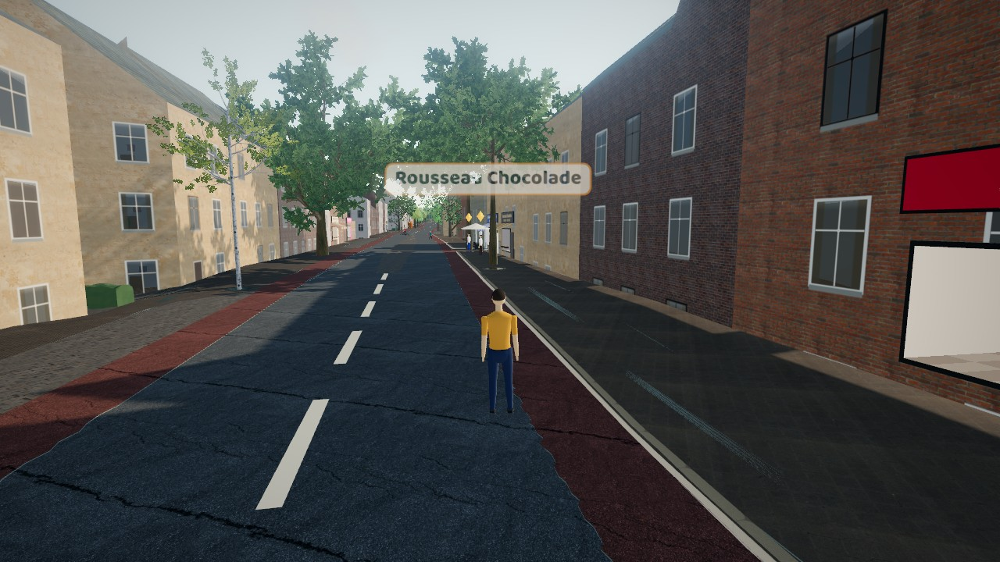 | 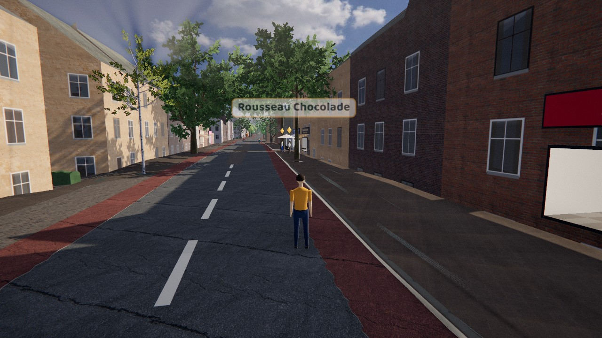 |
| Markt, dag | 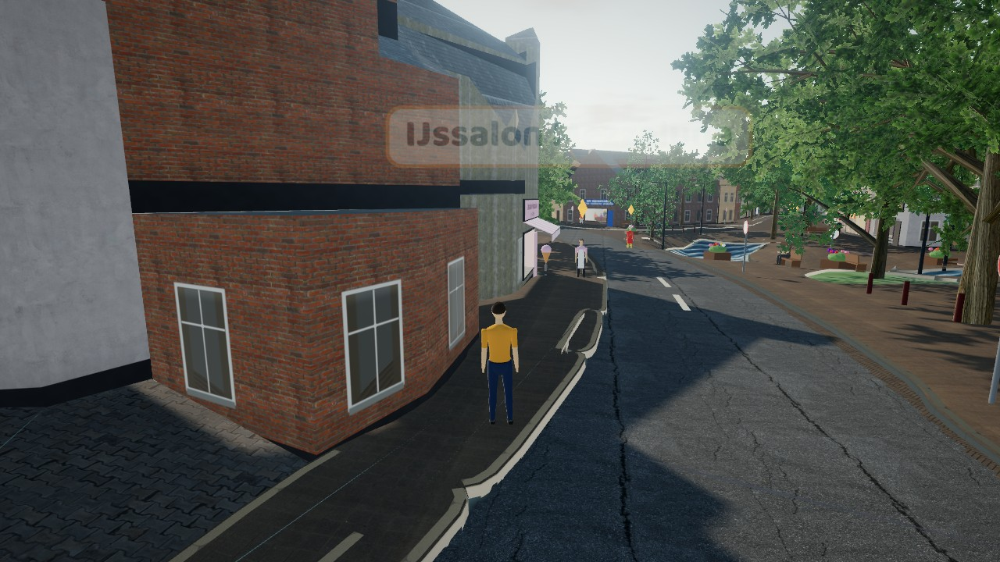 | 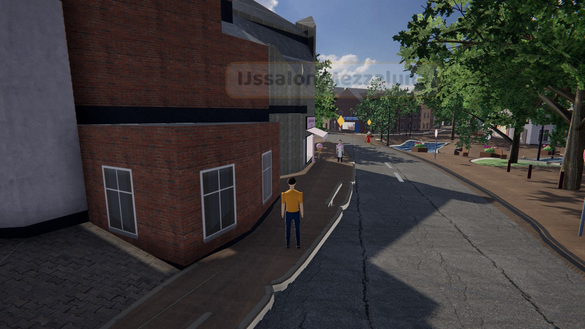 |
| Ringweg 38, dag | 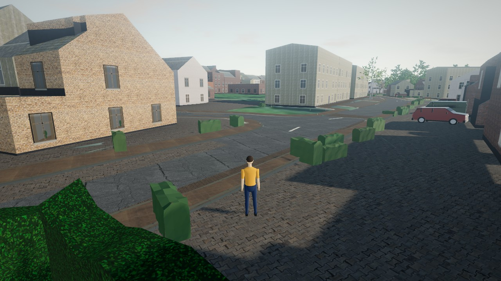 | 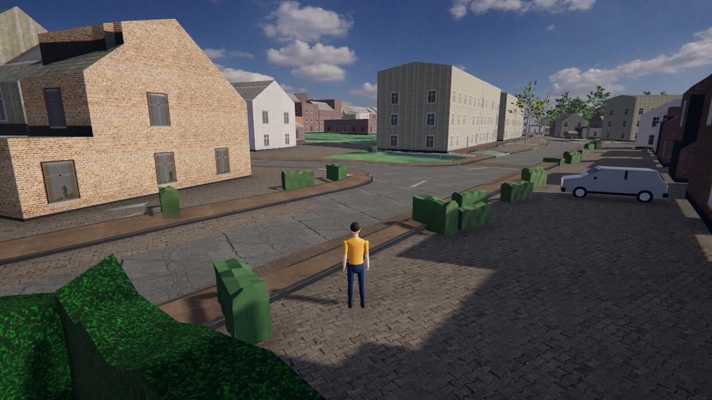 |
| Rijksweg, avond | 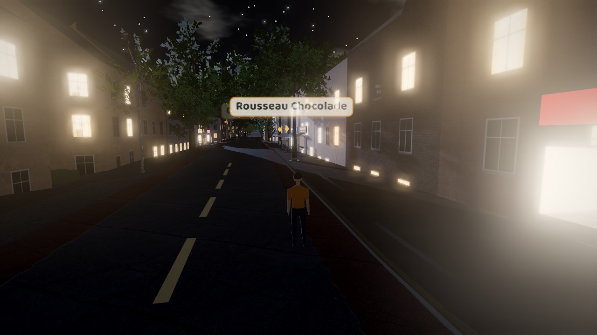 | 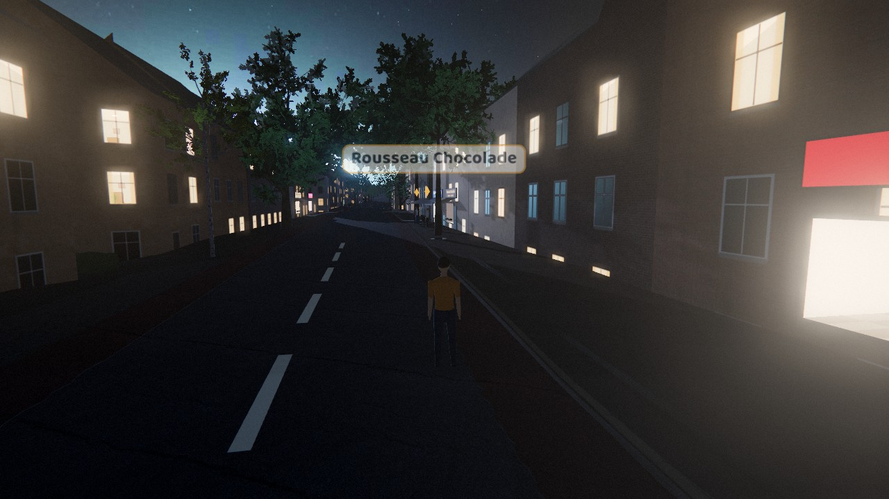 |
| Markt, telefoon | 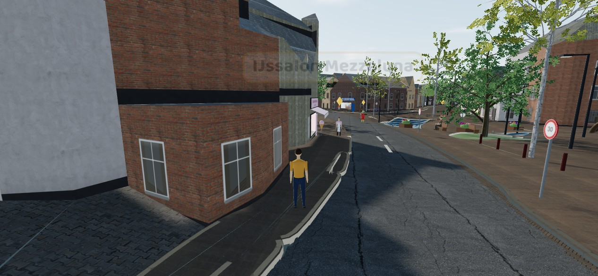 | 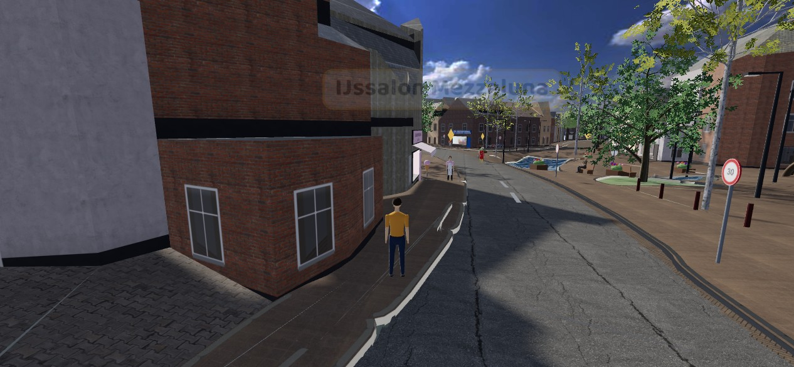 |

**Meting** (softwareweergave): computer 7,6 s per beeld (was 6,8; tijdens deze meting draaiden er andere zware processen mee), telefoon 4,6 s (was 4,2). De telefoonstand heeft geen nabewerking; het verschil daar is ruis van de meting.

**Geprobeerd en aangepast**
- Tone mapping AgX in plaats van ACES: gaf een flets, grijzig beeld. Teruggezet naar ACES met een eigen kleurcorrectie erachter.
- De eerste lucht (Kloofendal 38d, half bewolkt met sluierwolken) had precies de goede zonnestand maar oogde grijs. Vervangen door Kloofendal 48d (blauw met stapelwolken). Daar staat de zon 10 graden hoger dan in het spel; in plaats van de zon in het spel hoger te zetten (dan worden de schaduwen korter en verdwijnt het lage, warme licht) wordt de foto in de hoogte iets opgerekt, zodat de zon op de foto op 37 graden staat.
- De eerste nachtinstelling was melkachtig (te veel bloom en mist die oplichtte richting de maan). Bloom en mist zijn 's nachts teruggeschroefd.

## Stap 2: de avond (lantaarns die echt licht geven) en de poppetjes

**Lantaarns en avondlicht**
- De kaartdata (BGT) bevat voor heel Gulpen maar 40 lantaarns; de meeste straten waren 's avonds dus donker. `streetLamps()` in `src/world.js` zet er langs alle straten bij: om de 30 meter, om en om links en rechts, net naast de rijbaan, nooit vlak bij een bestaande lantaarn en niet pal voor de camera op het startpunt.
- De lantaarns geven nu echt licht op straat, gevels, auto's en mensen, zonder honderden echte lampen (dat kan een browser niet aan). De truc (`bakeLamps()` in `src/world.js`, shader in `src/lighting.js`): één kaart van het dorp met per vakje van 2 meter de lichtbron die daar het meeste licht geeft. Elk materiaal leest één vakje en rekent het licht van die ene lamp precies uit (afstand, richting, kegel naar beneden). Etalages zijn ook lichtbronnen en verlichten de stoep ervoor.
- Onder elke lantaarn hangt een zachte lichtkegel in de avondnevel. De oude platte lichtvlek op de grond is er alleen nog op de telefoon.
- Stoepranden en wegmarkering kregen geen zon- of lantaarnlicht: three.js keerde hun normaal om omdat ze van twee kanten getekend worden. Dat is hersteld (ook overdag zijn stoepranden nu licht aan de zonkant). Dezelfde reparatie bij het blad van de bomen: de bestaande aanpassing daarvoor deed in de praktijk niets, omdat het stukje shader op dat moment nog niet was ingevoegd.

| | Voor | Na |
| --- | --- | --- |
| Rijksweg, avond |  | 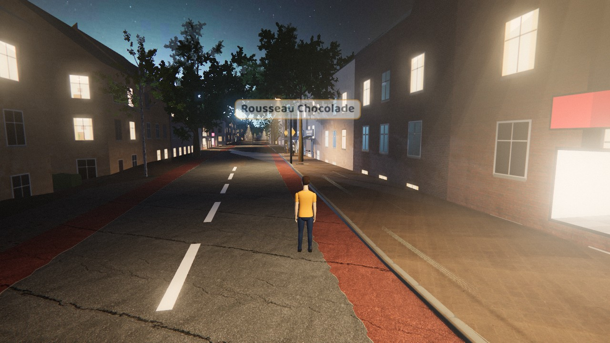 |
| Markt, avond | 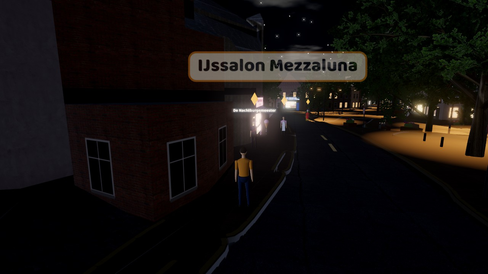 | 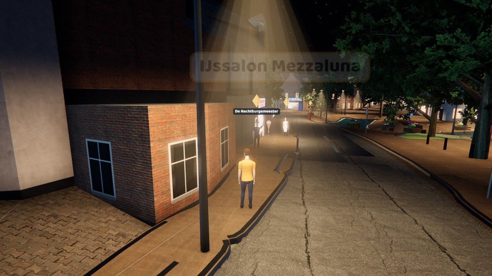 |

Geprobeerd en aangepast: de eerste lichtkegels waren harde, goed zichtbare 'feesthoedjes'. Ze hebben nu een eigen shader die uitdooft naar de rand. De eerste versie van de lichtkaart koos per vakje de dichtstbijzijnde lamp; dat gaf een zichtbare sprong op de grens tussen een etalage en een lantaarn. Nu wint de lamp die daar het meeste licht geeft, en is de overgang onzichtbaar.

**Poppetjes** (gemaakt door een hulpagent in een eigen werkkopie, daarna samengevoegd; details in `docs/hd/poppetjes/NOTITIES.md`)
- Lopen, joggen, rennen en zitten komen nu uit echte motion capture van Carnegie Mellon University (opnamen 35_01, 35_17, 09_01 en 14_31), omgerekend naar het eigen skelet met `tools/bake-mocap.mjs`. De stap loopt mee met de afgelegde afstand, zodat voeten bij loopsnelheid niet meer schuiven (gemeten op de testpagina: 0,04 m/s bij 1,3 m/s; de oude versie gaf 1,9 tot 3 m/s).
- Nieuw lichaam: borstkas, taille, bekken, kuiten, hals, kaaklijn, oren, neus, ogen met oogleden, handen met vingers en duim, schoenen met zool, kleding met boord en zomen. 5768 driehoeken per poppetje op de computer (was 3662), op de telefoon 3662.
- Fietsen zit niet in de CMU-data en is berekend gebleven, maar nu met het bekken op het zadel, voeten op meedraaiende trappers en handen aan het stuur.
- Niet opgelost: bij volle sprint (6,5 m/s) schuift de standvoet nog, omdat de snelste opname 3,6 m/s is. Op bankjes hangen de voeten ongeveer 7 cm boven de grond. Het MakeHuman-basismodel is niet geprobeerd.

| | Voor | Na |
| --- | --- | --- |
| Lopen | 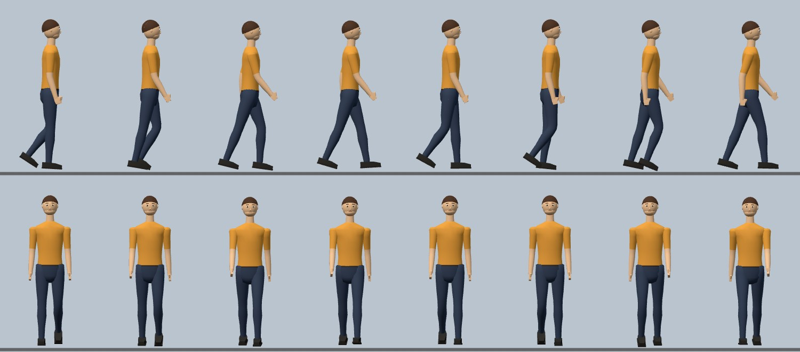 | 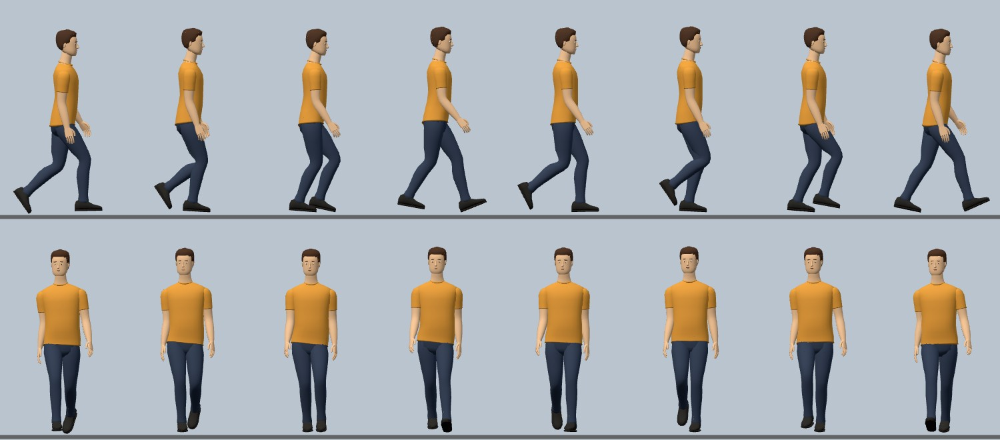 |
| Rij | 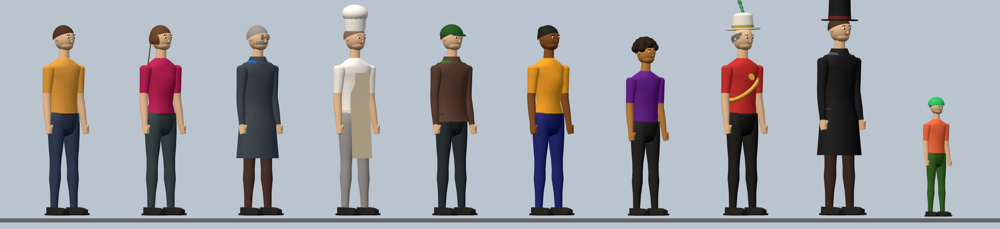 | 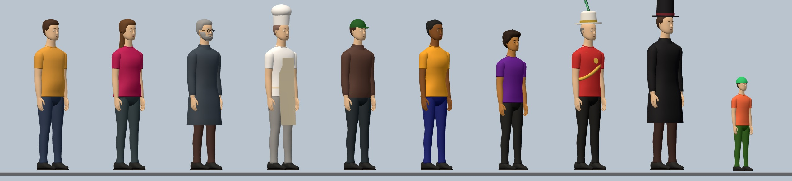 |

**Hagen en struiken**: een kern met daaromheen dunne schillen met losse blaadjes (uitgeknipt met een bladtextuur die in code wordt gemaakt). Dat geeft een bladerige, rafelige rand in plaats van een strak blok, en kost minder driehoeken dan de oude hagen (48 in plaats van 244 per stuk).

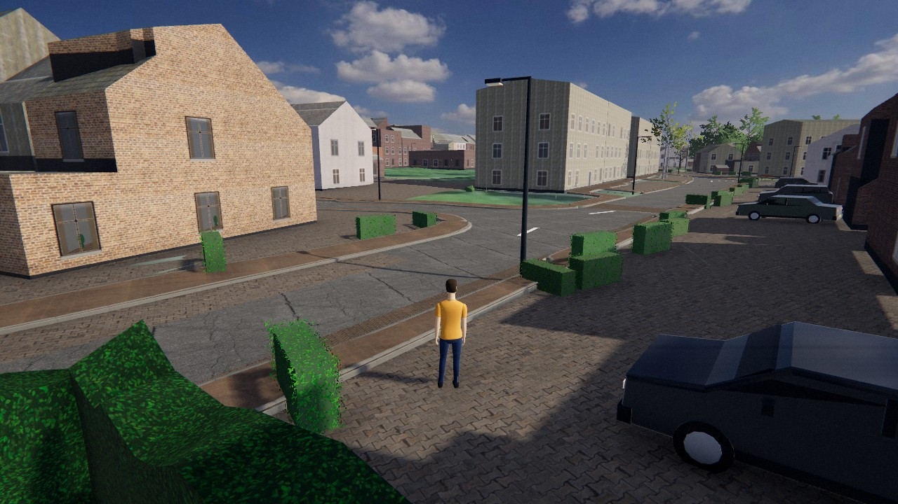

**Test**: alle 51 missies nagelopen met `tools/hd-missies.cjs`: geen fouten.

## Stap 3: gras, auto's, water en de natte avondstraat

**Gras** (`src/grass.js`)
- Rond de speler staan nu echte grassprieten, in twee ringen: dichtbij fijne sprieten (elke 17 cm een polletje, tot 10 meter), verderop grovere pollen tot 30 meter. Samen ongeveer 38.000 polletjes van vijf sprieten.
- De videokaart plaatst ze zelf: de plek volgt uit een vast raster in de wereld (het gras staat dus stil als je loopt), de hoogte uit de hoogtekaart, de vraag "is hier gras?" uit een graskaart (BGT-vlakken gras, berm en oever, zonder gebouwen en zonder de nagebouwde tuin van Ringweg 38), en de kleur uit de luchtfoto. Elke spriet heeft daardoor de kleur van de grond eronder, en het veld loopt verderop naadloos over in de luchtfoto.
- Het gras wuift in de wind en krijgt hetzelfde licht als de rest (zon, schaduw, lantaarns, mist).
- Alleen in de standen `hoog` (beide ringen) en `midden` (alleen de dichte ring). Op de telefoon geen gras.

| Voor | Na |
| --- | --- |
| 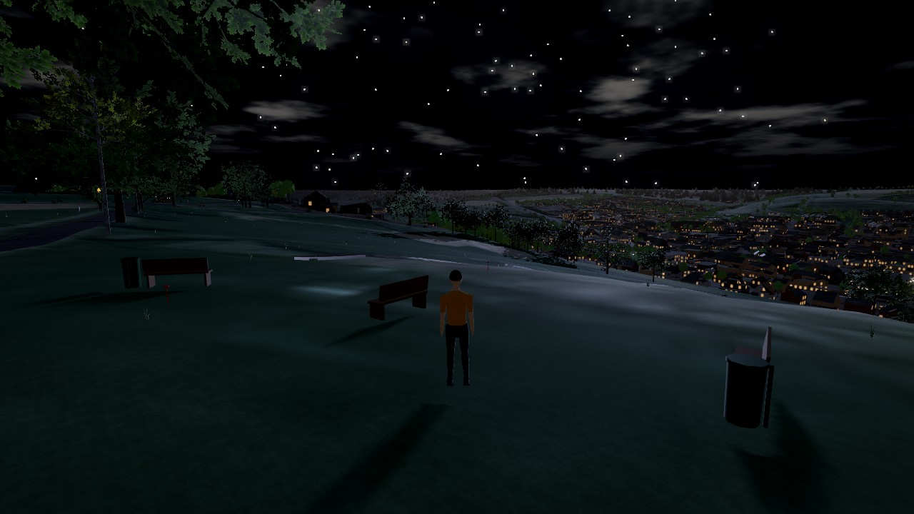 | 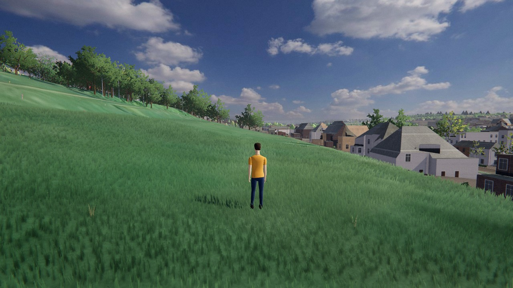 |

(De linkerfoto is een ander standpunt uit de nulmeting, om te laten zien hoe gras er eerst uitzag: een vlakke luchtfoto.)

Geprobeerd en aangepast: de eerste versie had te weinig en te donkere sprieten op een lichte ondergrond; dat oogde als losse stekels. Nu staan ze dichter, gebruikt het gras hetzelfde soort materiaal als het terrein (zodat het ook het hemellicht krijgt) en is de grond eronder iets donkerder gemaakt.

**Auto's** (gemaakt door een hulpagent in een eigen werkkopie, daarna samengevoegd; details en aantallen in `docs/hd/autos/NOTITIES.md`)
- Carrosserie als een reeks dwarsdoorsneden met vloeiende vormen (bolle neus en kont, schouders, echte wielkasten, naden, spiegels, deurgrepen), per type eigen verhoudingen. Maten voor botsingen en parkeren zijn gelijk gebleven.
- Doorzichtig getint glas met een interieur (stoelen, dashboard, stuur); verkeer heeft een bestuurder.
- Wielen draaien en sturen bij rijdende auto's. Remlichten, achteruitrijlicht, knipperlicht in bochten, en 's avonds koplampen met een lichtvlek op de weg en verlichte kentekens (verzonnen).
- De Volvo XC40 heeft zijn kenmerken behouden (zwart dak, knik in de ruitlijn, hamerkoplampen, turbinevelgen).
- Drie detailniveaus: een losse auto 18.000 tot 20.000 driehoeken, geparkeerd dichtbij 6.600 tot 7.500, ver weg en op de telefoon 1.700 tot 1.850.
- De spiegeling in lak en glas was afgesteld op de oude, zwakke omgeving; die is teruggezet nu de echte lucht het werk doet.
- Niet af: de XC40 gebruikt de algemene SUV-vorm met eigen maten en onderdelen; de wissel tussen het verre model (ondoorzichtig glas) en het nabije is zichtbaar als je erop let.

| Voor | Na |
| --- | --- |
| 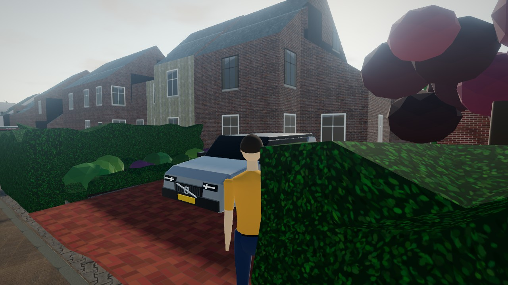 | 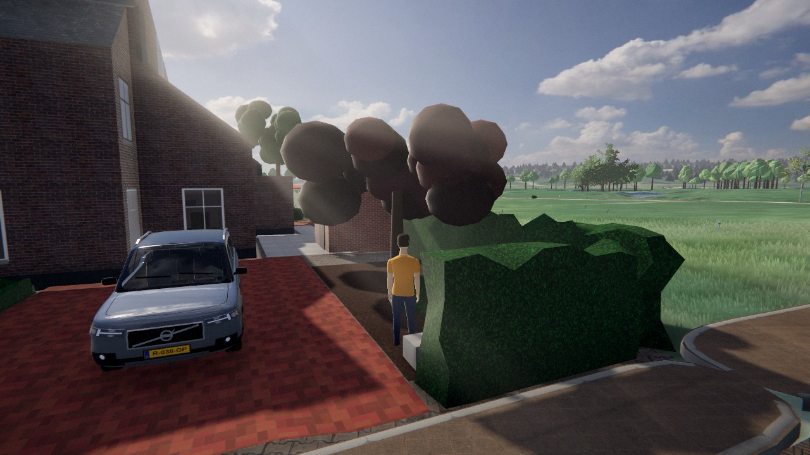 |

**Water** (`src/hardscape.js`): het water had grote, striperige golven. Nu is het donker en helder, spiegelt het de lucht (sterker naarmate je er vlakker overheen kijkt) en heeft het twee lagen fijne rimpels in wereldmaten die tegen elkaar in schuiven.

| Voor | Na |
| --- | --- |
| 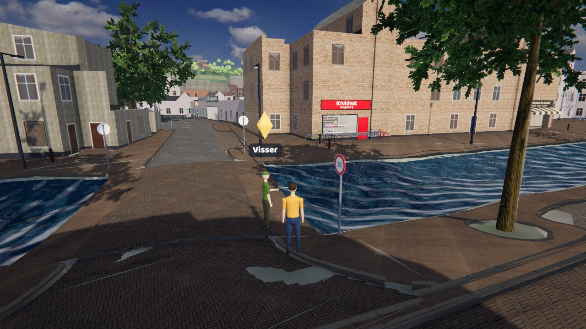 | 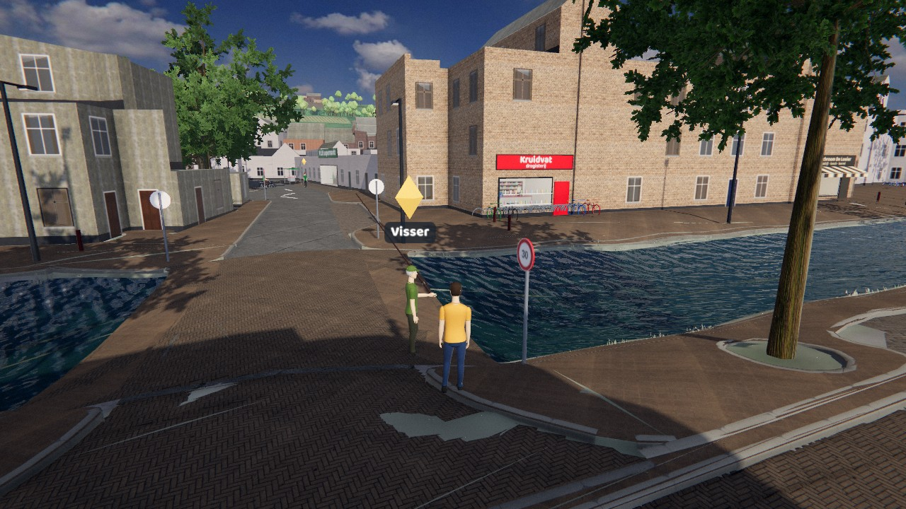 |

**Natte avondstraat** (`wetSurface` in `src/hardscape.js`): 's avonds is de straat nat, alsof het net geregend heeft. Het wegdek is donkerder en glanst, in de plassen spiegelt de lucht, en elke lantaarn krijgt een lichtveeg op het natte wegdek. Die veeg is een echte spiegeling: voor elk punt op de weg rekent de shader uit welke lantaarn daar in de spiegel zou staan, met dezelfde lichtkaart als het lantaarnlicht. Overdag is de straat droog.

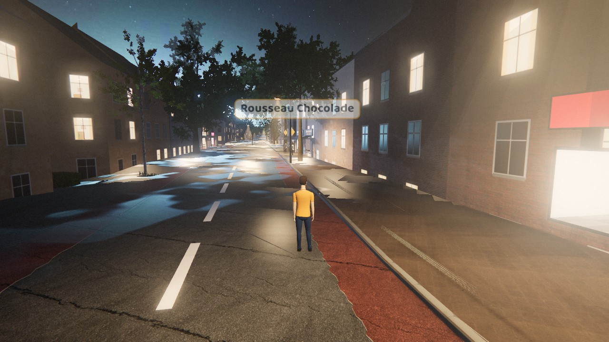

**Kleinere dingen**: de bolle kruinen en struiken in de tuin van Ringweg 38 hebben een bladmateriaal gekregen in plaats van kale vlakjes; het glas van de huizen is gladder, zodat de lucht erin spiegelt; boomblad heeft zachtere randen.
